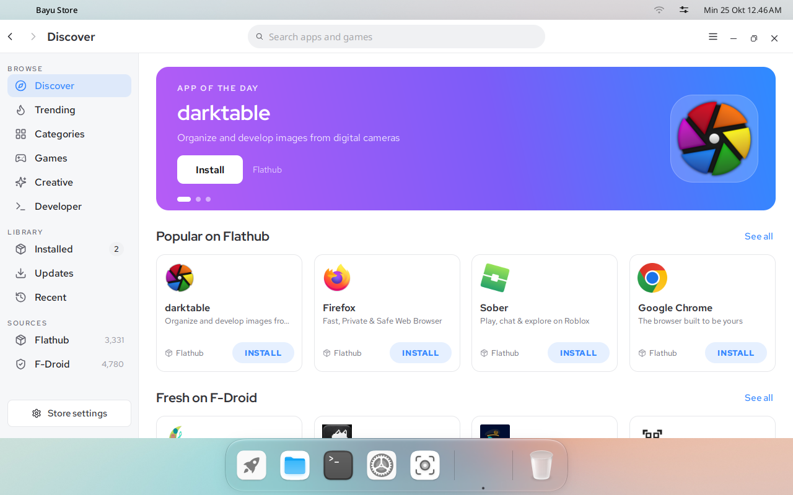
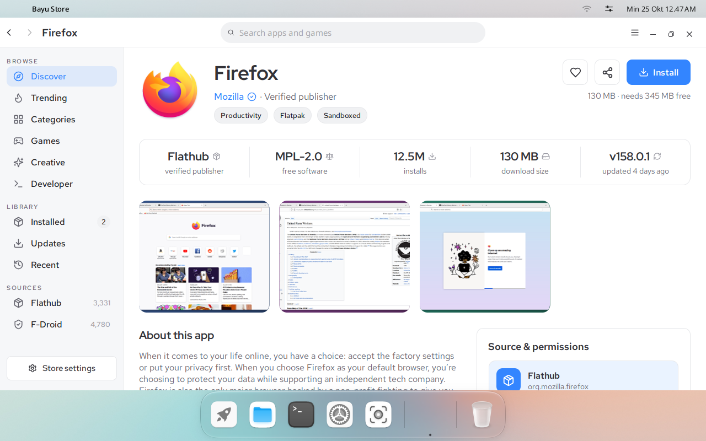
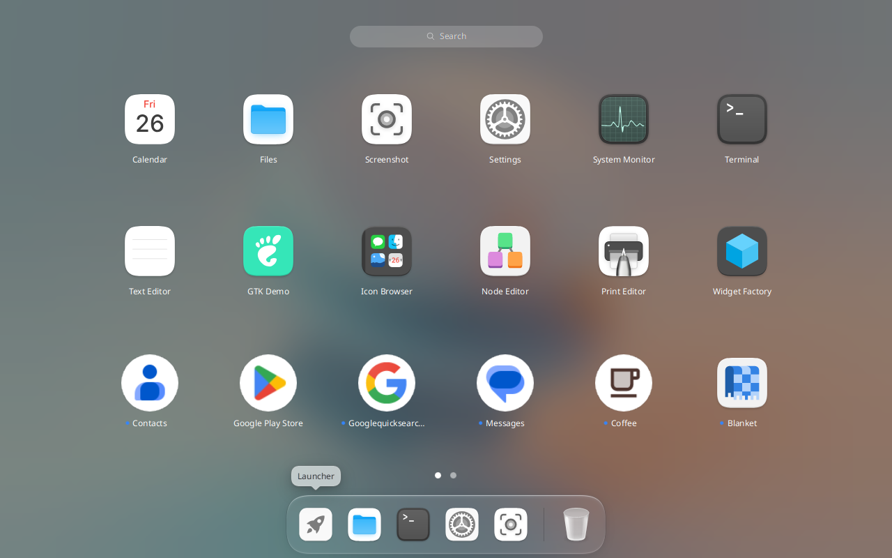
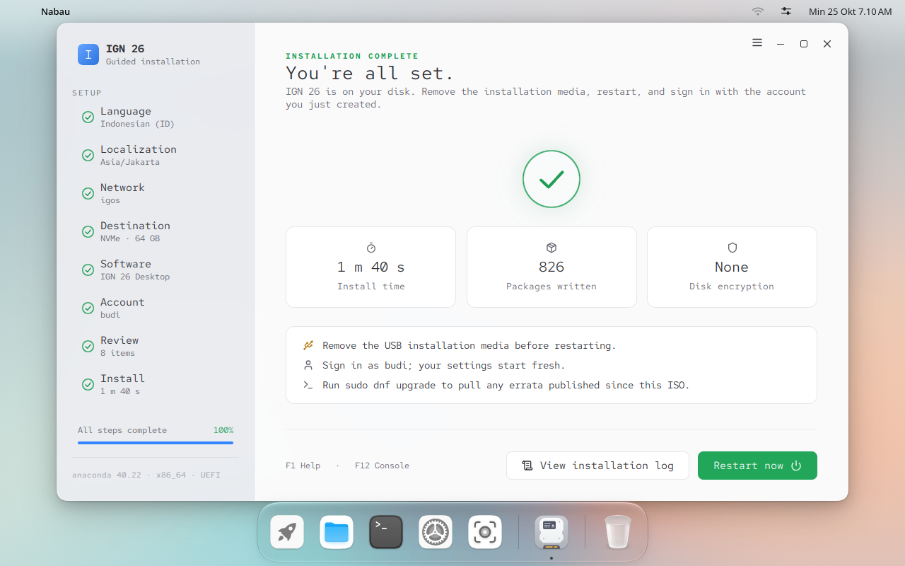

# Bayu

Bayu is a Wayland desktop environment, and the tooling to ship it as an
operating system on IGOS Nusantara 26 or AlmaLinux 10.

Bayu is a fork of [Cutefish](https://github.com/cutefishos). The desktop
components were forked from the Cutefish repositories and renamed
`cutefish` → `bayu`, and are developed independently since; the
upstream repository and revision of each component are listed in
[FORK.md](FORK.md). Nabau (the installer), Bayu Store and the packaging and
image builder are Bayu's own.

## Screenshots

| | |
|---|---|
|  |  |
| Bayu Store: apps from Flathub and F-Droid | An app page in Bayu Store |
|  |  |
| The launcher, with Flatpak and Android apps | Nabau after an installation |

## Contents

| Path | Purpose |
|---|---|
| `components/` | Desktop source: toolkit, compositor and shell, session, display manager, file manager, settings, terminal and applications |
| `build.sh` | Builds every component in dependency order |
| `packaging/` | RPM packaging: build container, `bayu-desktop` spec, kernel, Android support |
| `builder/` | Live ISO and disk image builder, with one profile per distribution |
| `.github/workflows/` | Continuous integration and releases |

## Requirements

A Linux host with Podman. Everything is built inside an AlmaLinux 10
container, so the host distribution does not matter. Building disk images
and ISOs needs `sudo` for loop devices; running them needs KVM.

## Building

### Packages

```shell
packaging/build-rpm.sh                    # bayu-desktop .rpm and .src.rpm
packaging/kernel/build-kernel.sh          # kernel with binder, for Android apps
packaging/fetch-lapis.sh                  # lapis, from its latest release
```

Each script adds its packages to `out/repo`, a local dnf repository the
builder installs from. The first desktop build downloads and compiles Skia
and takes a while.

### Operating system

```shell
builder/build-iso.sh                      # IGOS Nusantara: out/igos-bayu-live.iso
PROFILE=almalinux builder/build-iso.sh    # AlmaLinux: out/alma-bayu-live.iso
builder/build-image.sh                    # disk image: out/igos-bayu.qcow2
builder/run-vm.sh                         # boot the image, VNC on the Tailscale address
UEFI=yes builder/run-vm.sh out/igos-bayu-live.iso   # boot the ISO as a Mac would
```

The live ISO boots on BIOS and UEFI machines, from optical media or from a
USB stick written with `dd`, and starts the desktop with the profile's user
logged in.

### Testing packages on a running system

New packages do not need a new image. Serve `out/repo` and point systems at
it, then upgrade them after each build:

```shell
packaging/serve-repo.sh                   # http://<tailscale address>:8090/
sudo dnf upgrade --refresh bayu-desktop   # on the running system
```

Images and ISOs built with `BAYU_REPO_URL=http://<address>:8090/` in
`profile.conf` come with that repository; on another system, add it as a
repo file (see `packaging/serve-repo.sh`).

## Profiles

`PROFILE` picks the distribution the system is built from:

| Profile | Base | Repositories |
|---|---|---|
| `igos` (default) | IGOS Nusantara 26 | IGOS mirror on R2 |
| `almalinux` | AlmaLinux 10 | AlmaLinux, EPEL, RPM Fusion |

Both ship the same desktop, drivers and Android support. A profile is a
directory in `builder/profiles/`:

| File | Contents |
|---|---|
| `profile.conf` | Packages, user, locale, image and ISO names |
| `repos.d/` | dnf repositories to install from, plus Bayu's `out/repo` |
| `rootfs/` | Files copied over the system |

The logo Bayu shows in the panel, in Settings' About and in Nabau is the
theme icon that `LOGO=` names in `rootfs/etc/bayu/branding.conf`, its files
under `rootfs/usr/share/icons/hicolor/`; without it, `LOGO=` of
`/etc/os-release`. The `igos` profile ships the IGOS Nusantara logo.

The repository files are installed into the system too, so it updates from
the same place. To use another mirror or an internal repository, edit
`repos.d/`, or point the builder at other files:

```shell
CONFIG=/path/to/profile.conf REPOS=/path/to/repos.d builder/build-iso.sh
```

## Applications

Bayu's own applications use `components/bayu-toolkit`. Qt and GTK
applications follow the Bayu design system, one set of colour tokens, radii
and interaction states drawn by both toolkits:

| Toolkit | Integration |
|---|---|
| Qt 6 | The `bayu` widget style and platform theme (`components/qt-plugins`): Bayu's controls, colours, dark mode, fonts, icons and file chooser |
| GTK 3 and GTK 4 | The `Bayu` and `Bayu-dark` themes (`components/gtk-theme`), switched with dark mode |
| libadwaita | Dark mode only; libadwaita keeps its own style |

## First login

After the first login, Welcome (`bayu-welcome`, part of Bayu Store) offers a
short tour: Bayu Store and a first app to install, the launcher and dock,
Android apps (with a button that turns lapis on), dark mode and wallpapers,
and updates. It is not shown again unless asked to, and it stays off on
live media, where Nabau starts instead; the launcher opens it any time.

## Languages

Every component is translated into Indonesian, Javanese, Sundanese, Malay,
Simplified Chinese, Japanese, Korean, Spanish, French, German, Brazilian
Portuguese and Russian, with US English as the source. The catalogs are
`components/<component>/po/<language>.po`; after changing strings, run the
component's `update-translations` target to refresh its `.pot` and
merge it into each catalog.

## Hardware

Both profiles include the Broadcom `wl` driver (`broadcom-wl`,
`kmod-wl`), loaded automatically for the Wi-Fi chips it supports (BCM4311
to BCM4360, as in MacBooks up to early 2015). Newer Broadcom chips, such as
the BCM43602 of the 2015 MacBook Pro, use the kernel's `brcmfmac` with its
firmware, and Intel cards use `iwlwifi`. Apple keyboards, trackpads and the SMC use
drivers built into the kernel. UEFI Secure Boot must be off, since the Bayu
kernel is not signed by AlmaLinux.

## Android apps

[lapis](https://github.com/igos-nusantara/lapis) runs Android apps with
Google Play in a container, each app in its own window. It needs binder,
which the Bayu kernel provides. It is installed but off; to turn it on:

```shell
sudo systemctl enable --now lapis-control.socket
sudo lapis init                           # downloads Android, about 1.3 GB
lapis restart                             # start it now; later logins start it
```

Set `LAPIS_ENABLED=yes` in `profile.conf` to ship it enabled.

## Releases

Pushing a `vX.Y.Z` tag builds `bayu-desktop` X.Y.Z on AlmaLinux 10 and
attaches the `.rpm` and `.src.rpm` to a GitHub release. It also builds
the live ISO and uploads it to `repo/iso/nightly/ign26-bayu-harian-<timestamp>.iso`,
copied to `ign26-bayu-harian-latest.iso`, with the last 14 days kept,
on R2 (`.github/workflows/release.yml`, on the self-hosted runner). It also
adds the RPMs to the Bayu dnf repository on R2,
https://r2.igos-nusantara.or.id/26/bayu/, which the IGOS mirror host then
pulls into its `/var/www/html/26/bayu` (`builder/publish-repo.sh`):

```shell
git tag -a v0.2.0 -m "Bayu 0.2.0" && git push origin v0.2.0
```

The RPMs are signed with the IGOS repository key (`builder/sign-rpms.sh`,
fingerprint 4618 0BAE 950B 37E7 DCB6 0D38 8C6B F134 0021 5CA3). Systems
installed from an image update Bayu with `sudo dnf upgrade`. One
installed before the repository existed needs it added once:

```shell
printf '[bayu]\nname=Bayu\nbaseurl=https://r2.igos-nusantara.or.id/26/bayu/\nenabled=1\ngpgcheck=1\ngpgkey=https://r2.igos-nusantara.or.id/26/RPM-GPG-KEY-IGN-REPO\n' |
  sudo tee /etc/yum.repos.d/bayu.repo
sudo dnf upgrade
```

## License

Bayu is licensed under the GNU General Public License, version 3 or (at
your option) any later version; see [LICENSE](LICENSE).

The code forked from Cutefish keeps its BSD-3-Clause license: see
[LICENSE.cutefish](LICENSE.cutefish), the `LICENSE` file of each forked
component and the notices in its source files. [FORK.md](FORK.md) lists
what was forked and from where.
